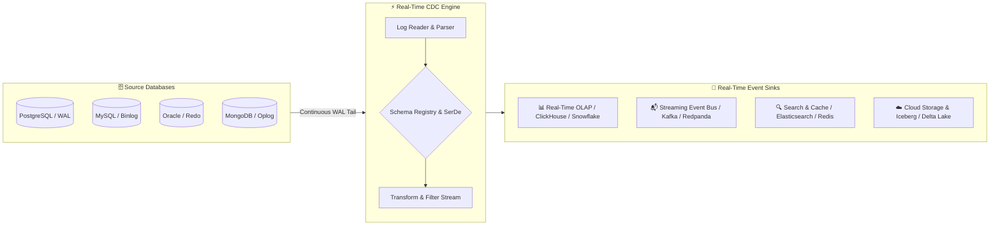

  

<h1 align="center">⚡ Awesome Real-Time Change Data Capture (CDC) ⚡</h1>

  <strong>Curated directory of SaaS platforms, enterprise managed replication services, and open-source engines for Real-Time Change Data Capture (CDC), database transaction log tailing, stream processing, and event-driven data integration.</strong>

  
  
  
  
  
  
  

---

## 📌 Overview & Architecture Blueprint

**Change Data Capture (CDC)** is a modern data integration pattern that detects, captures, and delivers row-level mutation events (inserts, updates, and deletes) from source database write-ahead logs (WAL / redo / binlogs) in real time. CDC empowers sub-second replication to cloud data lakes, event buses (Apache Kafka, Redpanda), analytical engines (ClickHouse, Snowflake), search indexes (Elasticsearch), and microservice caches (Redis) with minimal source database overhead.

---

## 📑 Table of Contents

- [🏢 SaaS & Hosted Commercial Platforms](#-saas--hosted-commercial-platforms)
- [💻 Open-Source GitHub Projects](#-open-source-github-projects)
  - [🚀 Streaming Engines & Distributed CDC](#-streaming-engines--distributed-cdc)
  - [🔌 Database Connectors & Log Tailers](#-database-connectors--log-tailers)
  - [🌊 Real-Time Data Pipelines & Gateways](#-real-time-data-pipelines--gateways)
- [🎯 Selection Guide: Log-Based CDC vs. Query-Based Polling](#-selection-guide-log-based-cdc-vs-query-based-polling)
- [🤝 How to Contribute](#-how-to-contribute)
- [💖 Support & Sponsorship](#-support--sponsorship)
- [📈 Star History](#-star-history)
- [📜 License](#-license)

---

## 🏢 SaaS & Hosted Commercial Platforms

> 📊 **Market Landscape & Industry Outlook:** The global Change Data Capture (CDC) and real-time streaming integration market is estimated at **$2.5 Billion in 2024**, projected to surpass **$6.8 Billion by 2030** (CAGR ~18.2%). The sector is **moderately fragmented**, anchored by mega-cap cloud incumbents (AWS, Oracle, Salesforce) providing platform-native CDC, while high-velocity specialized streaming vendors (Confluent, Fivetran, Qlik, Striim, Estuary) capture massive share across hybrid-cloud and heterogeneous operational-to-analytical data mesh pipelines.

> *Sorted descending by company size (Valuation / Market Capitalization / Scale).*

| Product | Company Size & Valuation | Focus & Core Capabilities | Starting Pricing | Free Tier / Free Trial Limits |
| :--- | :--- | :--- | :--- | :--- |
| **[Salesforce Change Data Capture](https://developer.salesforce.com/docs/atlas.en-us.change_data_capture.meta/change_data_capture/cdc_intro.htm)** | **~$300B+** Market Cap (CRM) • **$34.9B+** ARR | Native event-driven streaming of Salesforce record changes via CometD and Pub/Sub API based on the event bus architecture. | Included in Enterprise & Unlimited editions (**$165/user/month** Enterprise base; add-on event allocations start at **$1,000/mo**) | **Free Developer Edition** (includes 100,000 delivered CDC events per 24 hours forever; 30-day trial for enterprise orgs). |
| **[Oracle GoldenGate Cloud (OCI GoldenGate)](https://www.oracle.com/integration/goldengate/)** | **~$480B+** Market Cap (ORCL) • **$53B+** ARR | Enterprise transaction log tailing, bidirectional active-active database replication, mesh streaming, and heterogeneous cloud DB sync. | **$0.672 per OCPU/hour** (~$490/month base for 1 OCPU compute engine) on Oracle Cloud Infrastructure | **30-day free trial with $300 in cloud credits**; includes access to Always Free Oracle Cloud Autonomous DB & compute resources. |
| **[AWS Database Migration Service (AWS DMS)](https://aws.amazon.com/dms/)** | **~$2.0T+** Market Cap (AMZN) • **$105B+** AWS ARR | Managed replication engine supporting continuous CDC from relational/NoSQL databases to S3, Kinesis, OpenSearch, and Redshift. | Pay-per-use compute starting at **$0.018/hour** (~$13/month for `dms.t3.micro` instance) plus standard GP2/GP3 storage ($0.115/GB-mo) | **AWS Free Tier: 750 hours/month** of Single-AZ `dms.t2.micro` or `dms.t3.micro` instance usage free for **12 months** with 50 GB storage. |
| **[Qlik Replicate](https://www.qlik.com/us/products/qlik-replicate)** | **$5.0B–$7.0B+** Valuation (Thoma Bravo) • **~$1B+** ARR | Low-impact log-based CDC across mainframes, SAP systems, Oracle, SQL Server, and cloud warehouses with automated schema generation. | Standard enterprise licensing starting at **~$1,500/month** (~$18,000/year base server deployment license) | **30-day free trial** of Qlik Cloud Data Integration (full evaluation access for up to 5 endpoints and test pipeline workloads). |
| **[Fivetran HVR](https://www.fivetran.com/products/high-volume-replication)** | **$5.6B** Valuation (Series D) • **~$300M+** ARR | High-volume real-time enterprise log replication engine built for massive transactional databases, SAP HANA, Oracle, and DB2. | Starts at **$500/month** on Fivetran Standard tier (priced per Monthly Active Rows / MAR, scaling based on consumption) | **14-day free trial** with unlimited Monthly Active Rows (MAR) and full access to high-volume replication connectors. |
| **[Confluent Cloud CDC](https://www.confluent.io/product/connectors/)** | **~$8.5B+** Market Cap (CFLT) • **~$1.0B+** ARR | Fully managed Debezium and database log source connectors streaming CDC events into Apache Kafka with stream lineage and governance. | Serverless connectors start at **$0.11/hour** (~$80/month base per connector task) plus Confluent Cloud data transit consumption | **$400 in free credits** valid for the first **30 days** on Confluent Cloud; no credit card required to start evaluation. |
| **[Striim](https://www.striim.com/)** | **~$600M–$800M** Valuation • **~$75M+** ARR | Real-time streaming data integration and log-based CDC platform with in-flight transformation, streaming analytics, and multi-cloud sync. | Starts at **$2,500/month** on AWS/Azure Marketplace for Developer & Base editions (includes up to 10 GB/day streaming pipeline volume) | **30-day free trial** of Striim Cloud Developer Edition with up to 10 GB/day streaming ingestion limits. |
| **[Estuary Flow](https://estuary.dev/)** | **~$120M–$150M** Valuation (Series A) • **~$10M+** ARR | Real-time log-based CDC data integration platform with sub-second latency, built on open-source Gazette streaming architecture. | Free tier included; Paid Cloud starts at **$20/month** base plus data usage ($0.50/GB moved and $0.75/GB transformed) | **Free Forever plan** includes **10 GB/month data transfer**, up to 2 active capture tasks, and 5 active materialized collections. |
| **[Arcion (Databricks Lakehouse CDC)](https://www.databricks.com/product/arcion)** | **$100M** Acquisition Valuation *(Acquired by Databricks)* • Integrated into $43B Databricks | Agentless, distributed log-based CDC replication engine purpose-built for zero-downtime replication to Databricks Lakehouse and cloud stores. | Starts at **$1.50 per DBU (Databricks Unit)** (~$750/month entry tier workload) as Databricks Lakehouse Lakeflow Connect | **14-day free trial** with full Databricks workspace access and complimentary $400 cloud evaluation units. |
| **[Debezium Cloud (Aiven for Debezium)](https://aiven.io/debezium)** | **~$3.0B** Unicorn Valuation (Aiven) • **~$100M+** ARR | Hosted, managed Debezium CDC service integrated with Apache Kafka, OpenSearch, and PostgreSQL with automated high-availability clustering. | Starts at **$0.25/hour** (~$180/month) for Startup-2 cluster plan with dedicated compute, storage, and auto-backups | **30-day free trial with $300 in cloud credits** across all Aiven managed database and Debezium services. |

---

## 💻 Open-Source GitHub Projects

Curated collection of production-grade open-source CDC engines, log-tailing connectors, and real-time streaming pipeline frameworks.

> *Sorted descending by GitHub Stars_Count.*

### 🚀 Streaming Engines & Distributed CDC

- **[ClickHouse](https://github.com/ClickHouse/ClickHouse)**  🌟 `50,300+`  
  Blazing-fast real-time columnar analytical database system featuring native MaterializedPostgreSQL and MySQL CDC engines for continuous transaction replication.

- **[Apache Kafka](https://github.com/apache/kafka)**  🌟 `33,900+`  
  The de facto distributed event streaming platform powering enterprise Change Data Capture architectures via Kafka Connect ecosystem and partition logs.

- **[Canal](https://github.com/alibaba/canal)**   🌟 `29,700+`  
  Alibaba's MySQL binlog incremental subscription & consumer component providing distributed real-time data replication across heterogeneous services.

- **[Airbyte](https://github.com/airbytehq/airbyte)**  🌟 `22,200+`  
  Leading open-source data integration engine featuring log-based CDC connectors for PostgreSQL (pgoutput/WAL), MySQL, Oracle, and MSSQL.

- **[Debezium](https://github.com/debezium/debezium)**  🌟 `13,200+`  
  The premier open-source distributed platform for Change Data Capture. Tails transaction logs for PostgreSQL, MySQL, MariaDB, SQL Server, Oracle, Db2, and MongoDB.

- **[Apache SeaTunnel](https://github.com/apache/seatunnel)**  🌟 `9,700+`  
  Next-generation, high-performance distributed data integration engine supporting real-time multi-table CDC synchronization with dynamic schema evolution.

- **[Redpanda Connect (formerly Benthos)](https://github.com/redpanda-data/connect)**  🌟 `8,700+`  
  High-performance stream processor in Go with extensive connectors, CDC hydration pipelines, and resilient buffer-driven stream routing.

- **[Supabase Realtime](https://github.com/supabase/realtime)**  🌟 `7,600+`  
  Elixir-based real-time server that listens to PostgreSQL logical replication changes (WAL) and broadcasts JSON mutations over WebSockets.

---

### 🔌 Database Connectors & Log Tailers

- **[CloudQuery](https://github.com/cloudquery/cloudquery)**  🌟 `6,500+`  
  High-performance open-source ELT and data integration framework in Go with real-time sync plugins for cloud infrastructure and operational databases.

- **[Apache Flink CDC](https://github.com/apache/flink-cdc)**  🌟 `6,400+`  
  End-to-end CDC solution built on Apache Flink for real-time streaming ETL, full database synchronization, dynamic schema changes, and sub-second analytics.

- **[go-mysql](https://github.com/go-mysql-org/go-mysql)**  🌟 `4,900+`  
  Pure Go library for MySQL network protocol and replication parser capable of acting as a binlog slave to stream live database events.

- **[Maxwell's Daemon](https://github.com/zendesk/maxwell)**  🌟 `4,200+`  
  Lightweight Java application that reads MySQL binlogs and writes JSON-serialized row-level mutation events directly to Kafka, Kinesis, RabbitMQ, or Redis.

- **[LinkedIn Databus](https://github.com/linkedin/databus)**  🌟 `3,600+`  
  Pioneering source-agnostic distributed change data capture system providing millisecond-latency change streams with total transaction ordering.

- **[PeerDB](https://github.com/PeerDB-io/peerdb)**  🌟 `3,300+`  
  Postgres-first, high-throughput CDC data replication platform engineered to replicate Postgres data to Snowflake, BigQuery, ClickHouse, and Queues 10x faster.

- **[Meltano](https://github.com/meltano/meltano)**  🌟 `2,600+`  
  Declarative ELT framework utilizing Singer-compatible taps and targets with native log-based CDC plugins for Postgres, MySQL, and MongoDB.

- **[mysql-binlog-connector-java](https://github.com/shyiko/mysql-binlog-connector-java)**  🌟 `2,200+`  
  The foundational Java library used by Debezium and various CDC engines to read and decode MySQL binlogs in real time.

- **[Apache InLong](https://github.com/apache/inlong)**  🌟 `1,500+`  
  One-stop massive data ingestion framework providing automated database log capture, distributed queuing, and real-time streaming extract.

- **[Skeema](https://github.com/skeema/skeema)**  🌟 `1,300+`  
  Declarative schema management system for MySQL and MariaDB companioning CDC streaming setups with safe online DDL schema drift migrations.

- **[Estuary Flow Engine](https://github.com/estuary/flow)**  🌟 `980+`  
  Open-source runtime for Estuary Flow real-time CDC data integration, streaming connectors, and low-latency continuous data flows.

---

## 🎯 Selection Guide: Log-Based CDC vs. Query-Based Polling

| Feature / Metric | 📜 Log-Based CDC (Recommended) | 🔄 Query-Based Polling (`updated_at`) |
| :--- | :--- | :--- |
| **Source Impact** | **Near Zero** (reads WAL / binlogs from disk/memory) | **High** (frequent `SELECT` scans, index contention) |
| **Latency** | **Sub-second** (10ms – 500ms real-time streaming) | **Minutes to Hours** (batch interval polling delays) |
| **DELETE Detection** | **Native & Immediate** (logged as delete event) | **Impossible** without hard audit triggers / soft deletes |
| **Intermediate Changes** | **Complete history captured** (all states retained) | **Lost** (only latest state at scan time is seen) |
| **Schema Evolution** | **Handled automatically** with DDL schema tracking | **Manual reconfiguration** required upon column shifts |

---

## 🤝 How to Contribute

Contributions are welcome! If you know an open-source CDC library or SaaS replication platform that should be included:

1. 🍴 Fork the repository.
2. 🌿 Create a descriptive feature branch (`git checkout -b add-cdc-tool`).
3. 📝 Add your tool with links, pricing/stars, and architectural details in the correct section.
4. 🚀 Open a Pull Request.

---

## 💖 Support & Sponsorship

If you find this repository helpful in designing your real-time change data capture and streaming replication architectures, please consider supporting the project:

- ⭐ **Star** this repository on GitHub.
- 🔄 **Fork** and share with your data engineering & distributed systems teams.
- ☕ **Buy Me a Coffee / Sponsor**: Support ongoing maintenance, updates, and open-source tooling via the [GitHub Sponsor Dashboard](https://github.com/sponsors/ishandutta2007).

Thank you for supporting open-source data infrastructure! 🙏

---

## 📈 Star History

---

## 📜 License

Distributed under the **MIT License**. See [`LICENSE`](./LICENSE) for more details.
